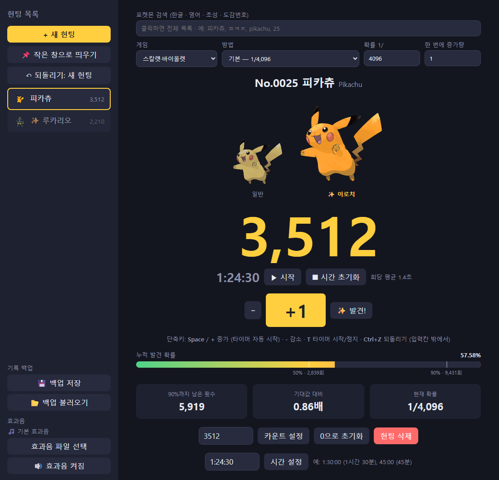

# ✨ 포켓몬 이로치 카운터

이로치(색이 다른 포켓몬) 헌팅 횟수와 시간을 세고, 지금까지의 누적 발견 확률을 보여주는 웹 카운터입니다.
설치 없이 `index.html`을 브라우저로 열면 바로 쓸 수 있습니다.



## 주요 기능

- **헌팅 여러 개 관리**: 포켓몬별로 카운트, 시간, 확률을 따로 기록
- **포켓몬 검색**: 한글 · 영어 · 초성(`ㅍㅋㅊ`) · 도감번호로 검색하거나, 도감번호 순 전체 목록에서 선택 (1~1025번)
- **일반 / 이로치 이미지** 나란히 표시
- **게임별 · 방법별 확률**: 스칼렛·바이올렛부터 금·은·크리스탈까지, 빛나는부적 · 국제교배 · 대량발생 · 연쇄낚시 등
- **누적 발견 확률 게이지**: `1 − (1 − 1/확률)^횟수` 계산, 50% · 90% 도달 지점 표시
- **타이머**: `+`를 누르면 자동으로 시작, 회당 평균 시간 표시, 시간 직접 수정 가능
- **발견 효과음**: 기본 합성음 또는 직접 고른 효과음 파일
- **작은 창**: 다른 프로그램 위에 항상 떠 있는 미니 카운터 (Chrome / Edge)
- **되돌리기**: `Ctrl+Z`로 최대 100단계
- **백업**: 기록을 `.json` 파일로 저장하고 불러오기

## 사용법

1. `index.html`을 Chrome 또는 Edge로 엽니다.
2. **+ 새 헌팅**을 누르고 포켓몬과 게임 · 방법을 고릅니다.
3. 만날 때마다 `Space`(또는 `+1` 버튼)를 누릅니다.
4. 이로치가 나오면 **✨ 발견!**을 누릅니다.

### 단축키

| 키 | 동작 |
|---|---|
| `Space` / `+` | 카운트 증가 (타이머 자동 시작) |
| `-` | 카운트 감소 |
| `T` | 타이머 시작 / 정지 |
| `Ctrl+Z` | 되돌리기 |

> 입력칸에 커서가 있을 때는 단축키가 동작하지 않습니다.

## 기록 저장

기록은 브라우저(localStorage)에 자동 저장됩니다.
브라우저의 사이트 데이터를 지우면 기록도 사라지니, 가끔 **💾 백업 저장**으로 파일을 남겨 두세요.

## 파일 구조

```
├── index.html          화면 뼈대 + 스크립트 연결
├── style.css           디자인
├── data/
│   ├── pokemon-data.js 포켓몬 이름 (도감번호, 한국어, 영어)
│   └── odds-data.js    게임별 · 방법별 확률표
└── js/
    ├── storage.js      저장 / 불러오기
    ├── pokemon.js      이미지 주소, 검색
    ├── stats.js        확률 계산
    ├── timer.js        타이머
    ├── sound.js        효과음
    ├── undo.js         되돌리기
    ├── backup.js       백업
    ├── hunts.js        헌팅 만들기, 카운트
    ├── search.js       검색창
    ├── render.js       화면 그리기
    ├── mini.js         작은 창
    └── main.js         시작점, 단축키
```

## 참고

- 포켓몬 이름과 이미지는 [PokeAPI](https://pokeapi.co/)를 사용합니다. 이미지를 보려면 인터넷 연결이 필요합니다.
- 확률은 커뮤니티에 널리 알려진 값 기준입니다. 틀린 값은 `data/odds-data.js`에서 고칠 수 있습니다.
- 개인이 만든 팬 프로젝트이며, Nintendo · Game Freak · The Pokémon Company와 관계가 없습니다. 포켓몬 관련 이름과 이미지의 권리는 각 권리자에게 있습니다.
